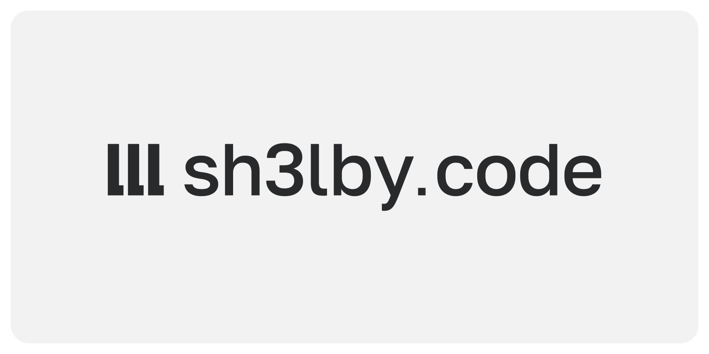

# LootDrop

<!-- portfolio-card:start -->
[](docs/portfolio/card.svg)
<!-- portfolio-card:end -->

A Telegram storefront prototype: game catalog, checkout previews, order history
and domain rules for payments and manual fulfillment. Python 3.12, aiogram,
SQLite and typed service boundaries.

The default mock provider makes no payment requests, returns no usable wallet
address and never confirms or settles payments. Docker Compose pins mock mode.

## Run

Copy `.env.example` to `.env`, set a dedicated demo `BOT_TOKEN`, then run:

```sh
docker compose up --build -d
```

The bot creates its SQLite schema and sample catalog at startup. No real user
database, original brand assets or secrets are included.

## Development

```sh
python -m pip install -e . pytest pytest-asyncio ruff
python -m pytest
ruff check app tests
```

`app/domain` holds order/payment policies; `app/services` orchestrates them;
`app/db` contains SQLite storage; `app/handlers` renders Telegram screens.
The CryptAPI adapter remains available in source behind the existing provider
protocol; it is not used in the demo.

## Prototype boundaries

The background worker is a placeholder and is not started by Compose. Settlement,
manual fulfillment and several payment callbacks are not yet wired end to end.
The demo shows catalog and invoice previews, not a production checkout.
Real-provider operation and live Telegram acceptance have not been verified.

MIT licensed. Maintained by sh3lby.code.
